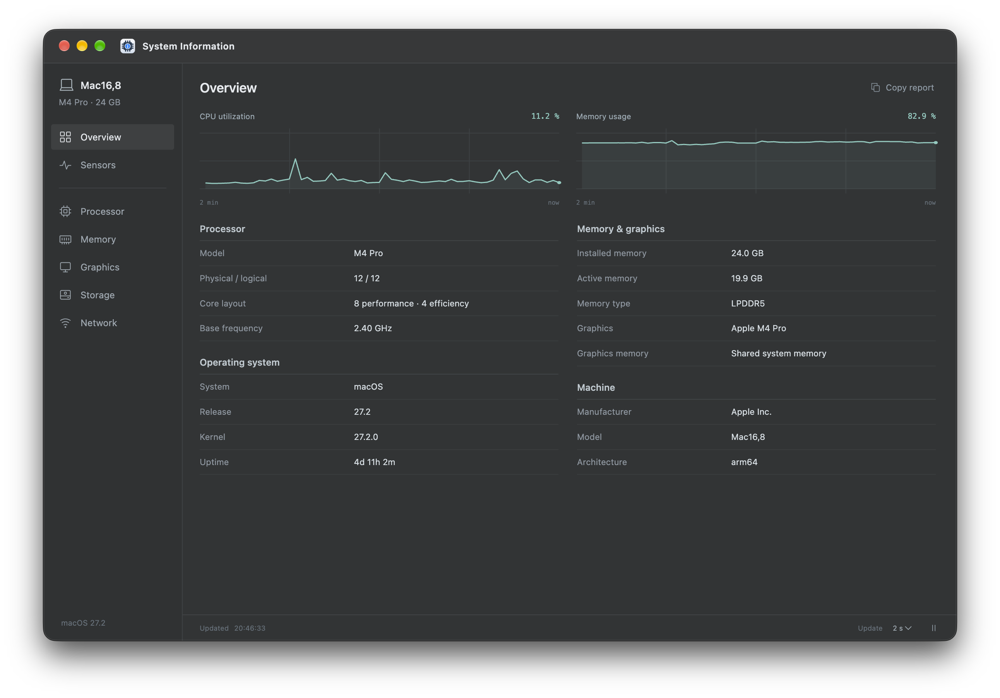
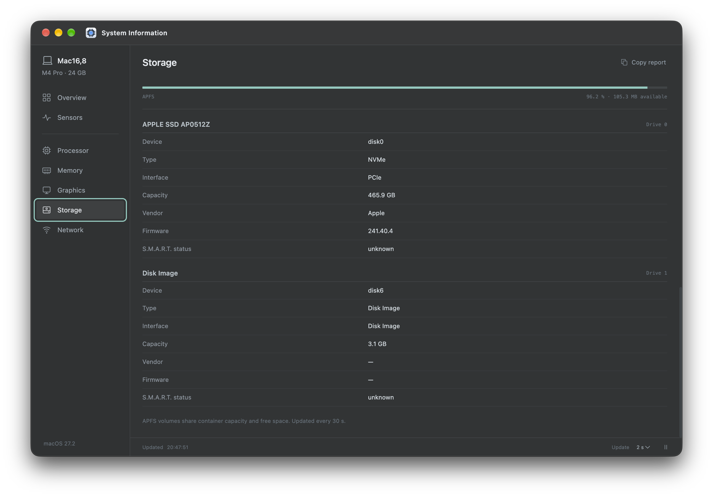

# System Information

Hardware information and live sensor monitoring for macOS, Windows, and Linux.

Download prebuilt apps from [Releases](https://github.com/GlamourDev/system-information/releases).

## Screenshots

| Overview | Storage |
| --- | --- |
|  |  |

## Setup

Requires Node.js 22.18 or later and npm. Run these commands from the project folder:

```sh
npm ci
npm start
```

`npm start` builds the source before launching the app.

## Build

Compile the app into `dist/`:

```sh
npm run build
```

Package a runnable app for your current operating system:

```sh
npm run package:dir
```

The packaged app is written to `release/`.

Create a release archive:

```sh
npm run package:release
```

## Checks

```sh
npm run lint
npm test
```

## License

[MIT](LICENSE)

## Sensors and availability

The Sensors page shows the source of native readings and a reason beside each
unavailable value. Missing, failed, and timed-out readings do not contribute to
minimum, maximum, or average statistics. Copied reports include the reasons.

- **Apple silicon Macs:** the bundled optional `macos-temperature-sensor` module
  reads CPU, GPU, SoC, die temperatures and fan RPMs through IOHID/SMC.
- **Intel Macs:** `osx-temperature-sensor` reads CPU sensors, plus SMC GPU and fan
  keys where the machine exposes them. Sensor/key coverage varies by model.
- **Windows x64:** the archive includes a persistent sensor helper, .NET runtime,
  and the official PawnIO driver installer. No separate Libre Hardware Monitor
  application or .NET installation is required. Open Sensors and choose **Set up
  hardware sensors** if prompted. This opens the bundled installer with the normal
  Windows permission prompt; it never installs silently. Finish setup and choose
  **Retry sensors**. If access is still limited, quit the app including its tray icon
  and launch it with **Run as administrator**. Some devices and driver policies
  still prevent individual readings. Disk activity includes operations/s and bytes/s.
- **Linux:** existing systeminformation readings remain available; additional
  native-provider sensors are not currently collected.

Fanless hardware has no fan readings. Not all hardware exposes every sensor,
including power and voltage on macOS. ACPI thermal zones are not presented as
CPU core temperatures. Zero RPM is valid for stopped fans.

Source builds need native compilation tools on macOS (Xcode Command Line Tools).
After installing dependencies, run `npm run rebuild:native` before launching with
Electron. Packaging rebuilds native modules for Electron automatically and unpacks
native binaries from ASAR. Optional module failures leave the application usable
with an explicit unavailable reason. Use a native build for each architecture.

### Building and troubleshooting Windows sensors

Install the .NET 10 SDK for source builds, then run `npm run build:windows-helper`.
The release and checks workflows do this automatically on Windows. Packaging fails
if the helper cannot be built. Dependencies are pinned in `packages.lock.json`;
the bundled PawnIO 2.1.0 installer is SHA-256 checked at build time and before launch.
Windows ARM64 packages are not supported by this helper build yet.

The helper communicates over local stdin/stdout, remains alive across samples,
releases hardware on app exit, and restarts after a timeout or crash with a 30-second
backoff. **Retry sensors** resets that delay and refreshes hardware inventory.
Errors distinguish missing binaries, invalid protocol, timeouts, driver setup,
permissions and unsupported devices. Partial readings remain usable.

The driver is system-wide and remains installed when the portable app is deleted;
use Windows Installed Apps to remove PawnIO if no other software needs it.
Licenses, upstream notices and source references ship in `resources/sensors/licenses`.
A Windows CI smoke check exercises two real helper requests; physical Windows and
Intel Mac validation is still required for device-specific sensor coverage.

### Sensor history

Sensors include two-minute trend lines and CSV export of that rolling window.
Missing readings remain blank in the export and break the trend line. Set an
optional temperature threshold in Sensors to show an in-app warning when it is
exceeded; blank disables it. This is a user-selected threshold, not a hardware
safety rating. History is held in memory and is not recorded after the app exits.
Drive sensors reported by the Windows helper also appear on Storage.

### Hardware inventory

The Hardware page shows motherboard and BIOS/firmware details, plus expandable USB
and audio device lists using the bundled systeminformation collector. Select
**Refresh hardware** after connecting or removing devices. Missing fields are marked
**Not reported**; failed queries show their available error reason. Field coverage
varies by operating system and device. BIOS and USB serial numbers are removed
before inventory reaches the interface. This does not add SPD/XMP decoding, deep
PCIe topology.

### Storage health

Storage shows SMART assessment, power-on hours, power cycles, SSD endurance used,
spare capacity, error counters and lifetime reads/writes where the drive reports
these. ATA attributes expand into a raw/normalized table; NVMe exposes health
counters instead. Vendor-specific ATA wear fields are not guessed into a percentage.

macOS (Apple Silicon and Intel) and Windows x64 releases include **smartmontools 7.5**
(`smartctl`) and its drive database. No separate installation or runtime download is
needed. Some drives require administrator access; USB/RAID adapters may block SMART.
The page explains missing resources, permission, timeout and unsupported-data
conditions. Existing Windows sensor-helper readings are available independently.

For development, run `npm run build:smartmontools` before starting the app. macOS
builds require the Xcode command-line tools; Windows packaging uses 7-Zip (included
on GitHub's Windows runners) to extract the official executable without running its
installer. `SMARTMONTOOLS_7Z` can select another 7-Zip executable. Linux continues to
use system smartmontools. Packaging builds the resources automatically; downloads
are pinned by SHA-256 in `native/smartmontools/release.json`.

Each bundle includes the upstream GPL license, notices, complete matching source
archive and build recipe under `Resources/smartmontools` on macOS or
`resources/smartmontools` on Windows. smartctl remains a separate command-line tool.

Health is read at startup and through **Refresh storage health**, not on every live
sensor tick. Collection only reads drive data; it does not run self-tests or alter
SMART settings. Raw serial numbers/WWNs are not forwarded to the UI or copied report.
